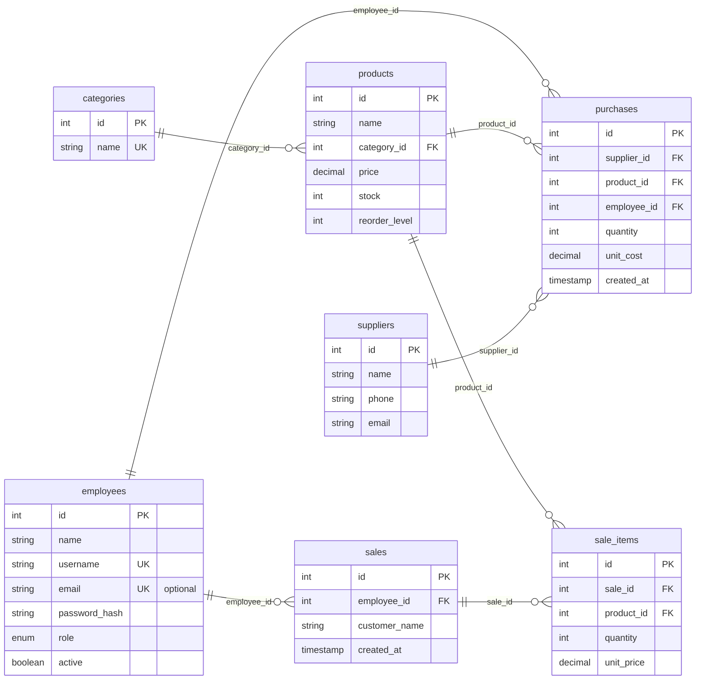

# Hardware World - database diagram

Generated from the live MySQL schema **hardware_world_simple**: **7 tables** and **7 foreign-key relationships**.

In VS Code, this file is configured to open as a visual preview. If you see the source, press **Ctrl+Shift+V**. Use the diagram controls to zoom, or hold **Alt** and scroll; Alt-drag pans.



**PK** = primary key; **FK** = foreign key; **UK** = unique field. **optional** means the field allows NULL. The forked end of a relationship means many; the double line means exactly one.

## How the tables connect

| Parent field | Referencing field |
| --- | --- |
| `categories.id` | `products.category_id` |
| `employees.id` | `purchases.employee_id` |
| `products.id` | `purchases.product_id` |
| `suppliers.id` | `purchases.supplier_id` |
| `products.id` | `sale_items.product_id` |
| `sales.id` | `sale_items.sale_id` |
| `employees.id` | `sales.employee_id` |

## Explain it to your lecturer

- Categories group products.
- Employees record sales and receive purchases.
- A sale contains sale items; each item points to a product.
- Each purchase links a supplier, a product, and the employee who received it.
- `products.stock` holds the current quantity; purchases increase it and sales reduce it.

## Refresh after changing table structure

In VS Code, run **Terminal -> Run Task -> Database: Refresh ER diagram**, or run:

```powershell
backend/.venv/Scripts/python.exe backend/generate_diagram.py
```

This is a schema snapshot generated locally. It reads table metadata and does not change records. Use SQLTools to browse live rows.
