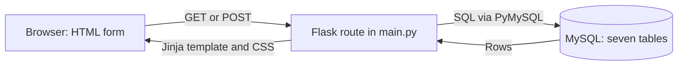
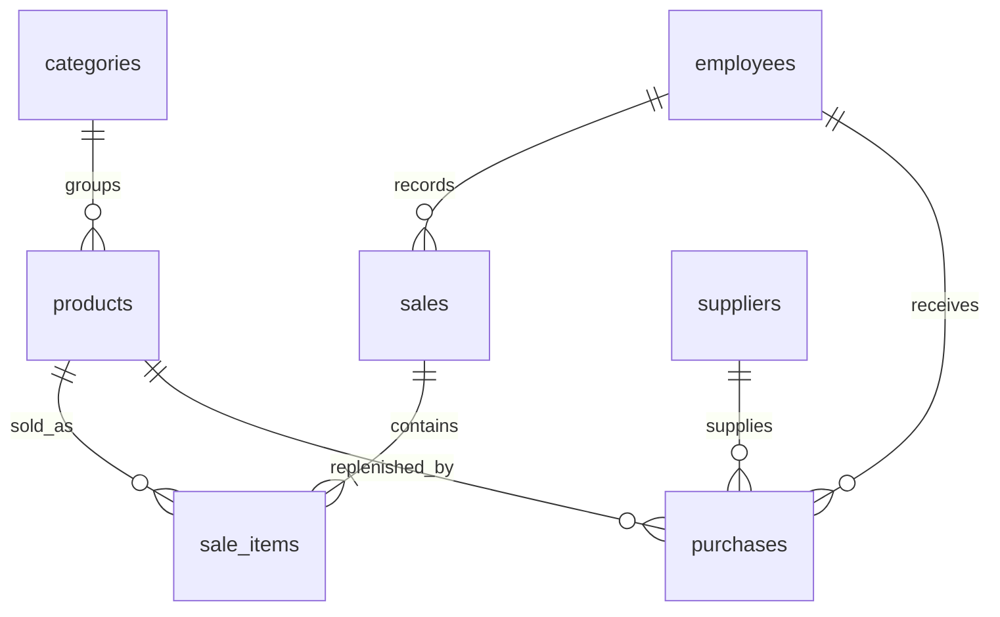

# Explaining Hardware World

## Your introduction

“My project manages a hardware store. It keeps product records, receives stock from suppliers, and records sales. HTML and CSS provide the frontend. Flask processes forms and renders pages. MySQL stores the data, and I use MySQL Workbench to inspect it.”

## How a page works

1. The browser requests `/products.html`.
2. Flask checks that the employee is signed in.
3. SQL reads products and categories from MySQL.
4. `render_template` passes those rows to `products.html`.
5. Jinja loops build the HTML table, and CSS styles it.
6. A form sends a POST. Flask validates it, changes the database, commits, and redirects to the page.

Read `products()` in `backend/main.py`, then `frontend/products.html` and `backend/schema.sql`. These show the full request flow.

## Table relationships

A primary key uniquely identifies a row, such as `products.id`. A foreign key links rows: `products.category_id` references `categories.id`. One category has many products.

A sale has several products, and a product can appear in many sales. `sale_items` connects them and stores quantity and price. Each purchase records one delivered product from one supplier. Customer names go directly on sales; there is no customer account system.

## Two calculations

**Purchase:** old stock + received quantity = new stock. Starting with 10 and receiving 5 gives 15.

**Sale:** old stock − sold quantity = new stock. Selling 3 leaves 12. At a price of 20,000, the line total is 3 × 20,000 = 60,000. Add line totals for the receipt total.

Flask reads prices from MySQL. Each sale item keeps its historical price, so changing today's product price does not alter old receipts.

## Lecturer questions to practise

**Why Flask?** It provides routes, forms, sessions, and templates with little setup, suitable for this small application.

**What is a route?** A Python function mapped to a URL, such as `products()` for the products page.

**What is Jinja?** Flask's template engine. `{{ ... }}` displays values, `` repeats HTML, and `` controls what appears. `base.html` supplies the shared layout.

**GET versus POST?** GET reads pages or searches products. POST submits changes. Successful POST requests redirect to GET, so refreshing the result page does not resubmit the form.

**What is CRUD?** Create, Read, Update, Delete. Products, categories, and suppliers demonstrate it. Historical sales and purchases are read-only.

**What is a JOIN?** It combines related rows. The products query joins categories to show category names instead of only IDs.

**What is a transaction?** Changes that succeed or fail together. A sale, its items, and stock deductions commit together. Insufficient stock rolls back the entire sale.

**What if two people sell the last item?** `SELECT ... FOR UPDATE` locks the product row. The second transaction waits, then checks updated stock.

**Why DECIMAL for money?** It stores exact decimal amounts and avoids binary floating-point rounding errors.

**How do you prevent SQL injection?** Queries use `%s` placeholders and pass values separately to PyMySQL.

**How does login work?** The user selects a department and enters their username and password. Flask finds the active employee by unique username, checks the selected department matches the saved role, and verifies the password hash. It stores the employee ID in a signed session cookie and checks the account is still active on each request.

**Are passwords plain text?** No. Werkzeug creates and verifies password hashes.

**What are the roles?** Admin has full access and manages employee accounts. Sales records sales, views receipts, and reads product stock. Purchasing manages products, categories, suppliers, and received purchases. Everyone can access their own account and dashboard.

**How is role-based access enforced?** Each employee has one role in the employees table. `permissions.py` maps roles to allowed pages and HTTP methods. Flask checks this table before running a route and returns 403 for disallowed actions. The same table controls which links and buttons the templates show. Hiding a link alone would not protect the server.

**Can Sales edit products?** No. GET requests can read the catalogue, but POST requests that change products are blocked. The product form and edit/delete actions are also hidden.

**Can Purchasing see sales?** No. Its dashboard shows stock information and purchasing links. Sales totals, history, and receipts are restricted to Admin and Sales.

**How do I assign a department?** An Admin opens Employees and selects Sales or Purchasing as the employee's role. The employee selects a department on the sign-in page, but it must match their saved role. Selecting Admin does not give them Admin access. If an Admin changes their role, the new access applies on the next request.

**Where are employee accounts stored?** In the MySQL `employees` table: ID, full name, unique username, optional email, password hash, department role, and active status. Admins create accounts on the Employees page. There is no public sign-up.

**Why usernames instead of emails?** Each employee has a short, unique login name assigned by the Admin. Email is optional contact information. Passwords are still hashed.

**Why no department table?** This version needs only three fixed access groups. A single role column keeps the schema small and easy to explain.

**What is CSRF protection?** Each form has a random token tied to its session. Flask rejects POST requests without a matching token.

**Why can't a sold product be deleted?** Foreign keys protect transaction history. Suppliers with purchases and categories with products are protected too.

**Is Workbench the database?** MySQL is the database server. Workbench is the desktop tool for connecting, browsing tables, and running SQL.

**Why seven tables?** They cover this store's core work. Payroll, branches, warehouses, ledger, and approvals are outside this version.

**What are the limitations?** One store, whole-unit quantities, immediately paid sales, three product lines per form, and one product per received purchase. No credit, taxes, discounts, refunds, payroll, or accounting.

## Five-minute demonstration

1. Sign in and show the dashboard.
2. Create a category, supplier, and product with stock 10.
3. Receive 5 units; show stock rising to 15.
4. Sell 3; show the receipt and stock of 12.
5. Attempt to sell more than 12; explain validation and rollback.
6. Show the records in Workbench.
7. Sign in as Sales and show that product editing and purchases are unavailable. Sign in as Purchasing and show that sales are unavailable.
8. Open `permissions.py`, `products()`, and the product template to explain the access check.

Practise changing a product name and explaining its SQL query. Understanding a small flow is more useful than memorizing the codebase.
