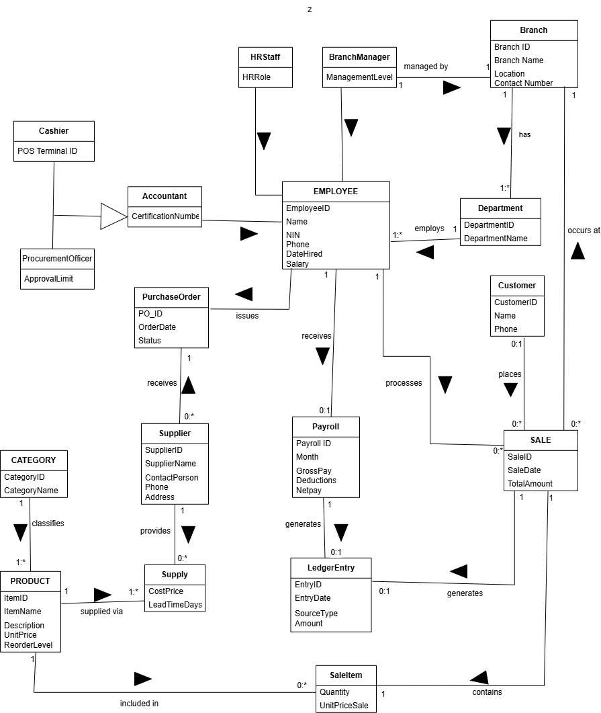
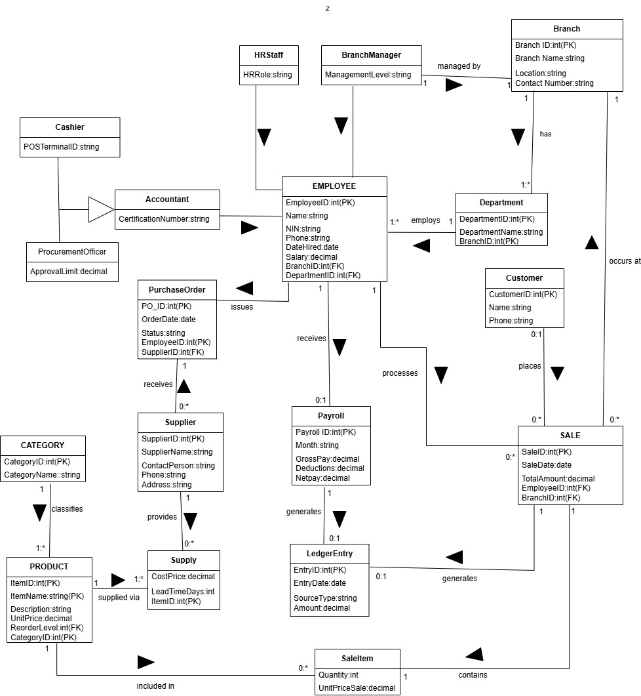
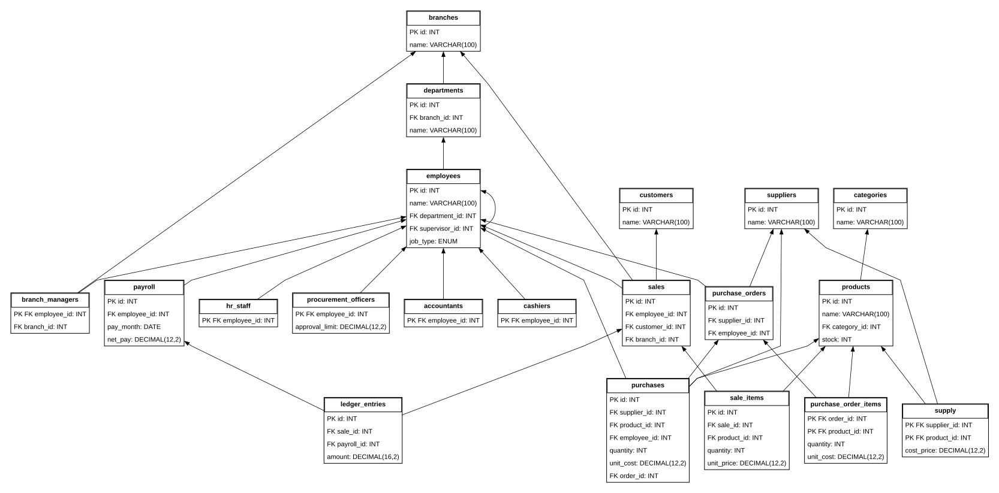

# Hardware World Database Management System

## Project report and practical study guide

Makerere University

Bachelor of Science in Computer Science

Course: Database Management Systems

Lecturer: Mrs. Komugisha Lillian

Project branch: akena2

Technology: Flask, Python, HTML, CSS and MySQL

Date: 28 October 2026

This report explains the Hardware World system, its database design, its implementation and the SQL concepts used. It is written in short sections that can be copied by hand. The conceptual and logical drawings from the supplied assignment are retained on separate pages. The physical model describes the implemented database.

The finished database contains 20 tables. Eighteen represent the entities shown in the assignment. Two support implementation: purchase_order_items records the products ordered, and purchases records stock actually received. The project keeps its original backend and frontend folders and its Flask, HTML and CSS structure.

Group members: Akena Jonathan Ogaba; Muwanguzi David Jeremiah; Okuja Emmanuel Dila John; Mutebi Steven; Ssemwogerere Godwin.

<!-- page -->
# Problem statement and choice of system

## Problem statement

Hardware World sells hardware and construction materials. Its activities involve products, suppliers, employees, customers, sales, procurement and payroll. When these records are kept separately, staff may repeat information, lose transaction details or struggle to determine the available stock.

A sale must reduce stock and preserve the price charged. A delivery must increase stock. Payroll must record gross pay, deductions and net pay. Managers need a common view of sales and payroll movements. The database must connect these processes and prevent incomplete transactions from leaving contradictory records.

The problem is therefore to develop a simple, connected system that stores business records reliably, controls access and produces useful records for daily operations and management.

## Why we chose Hardware World

The hardware retail business provides clear examples of database concepts. Categories and products illustrate one-to-many relationships. Suppliers and products illustrate many-to-many relationships. Employees and their supervisors illustrate a recursive relationship. Employee job types illustrate specialization. Sales and payroll illustrate transactions and triggers.

The system also solves a practical operational problem: a user can record a sale, see the remaining stock, obtain a receipt and back up the resulting records through one application.

## Aim and objectives

Our aim is to implement a manageable database application for Hardware World. Our objectives are to maintain organized records, process sales and deliveries atomically, record payroll, generate ledger entries, enforce access roles and support recovery through CSV backups.

The application is an educational implementation. It records global product stock rather than stock per branch. It does not implement refunds, tax calculations, customer credit, statutory payroll calculations or a full double-entry accounting system.

<!-- page -->
# System requirements and support

## Functional requirements

The system shall authenticate employees using a username, password and access role. An Admin shall create employee accounts and assign permissions. Sales staff shall record sales and access receipts. Purchasing staff shall manage the product catalogue, suppliers, deliveries and purchase orders.

The system shall store branches, departments, customers and all five employee subtypes. It shall record supplier-product costs and lead times. An Admin shall maintain staff profiles, process monthly payroll and view the ledger and data quality checks.

A sale shall validate stock, save its items and reduce stock in one transaction. Receiving a purchase order shall add stock once. After a successful sale, Flask shall save a Word receipt. Successful application changes shall request a complete CSV snapshot.

## Nonfunctional requirements

Data integrity requires primary keys, foreign keys, unique constraints and appropriate checks. Money must use DECIMAL rather than floating-point storage. Security requires hashed passwords, parameterized SQL, CSRF checks and server-side authorization. Reliability requires rollback when a transaction fails and a tested backup restore process.

Usability requires ordinary HTML forms, readable tables and consistent navigation. Maintainability requires small Python modules and readable SQL without introducing a new frontend framework or ORM.

## Hardware and software requirements

A normal development computer, a browser, storage for the database and backups, and network access when demonstrating to another computer are sufficient. A practical development target is at least 4 GB RAM, with more memory useful when running an editor and Workbench together; this is guidance, not a measured minimum.

Required software is Python 3.11 or later, MySQL 8.0.16 or later for enforced CHECK constraints, and the packages in backend/requirements.txt. MySQL Workbench is useful for SQL demonstrations. Waitress runs the complete application on Windows. No separate JavaScript build system is required.

## Operational support

The Admin manages accounts, reviews missing data and retains backups. If the application cannot connect, check that MySQL is running and that the root .env settings are correct. If port 8000 is occupied, stop the previous server or use a different port. Keep backups on another device as well as on the application computer.

<!-- page -->
# System analysis and business rules

## Main actors and processes

The Admin manages the system and performs HR and accounting work. A Sales user records purchases by customers. A Purchasing user manages suppliers and stock replenishment. Customers and suppliers are business entities; they do not sign in to this application.

The sales process accepts a customer and product quantities, checks available stock, stores the sale and its items, deducts stock and commits. MySQL creates a ledger entry during the transaction. Flask then produces the receipt and requests a CSV backup.

The procurement process creates a pending purchase order. Its products, quantities and costs are stored separately as order lines. Receiving the order records deliveries and increases stock. The order changes to Received, preventing a second receipt of the same order through the application. The original direct-delivery form is retained for stock already received without a pending order.

The payroll process stores one record per employee per month. MySQL calculates net pay as gross pay minus deductions. A trigger creates a negative payroll entry in the same ledger used for positive sale entries.

## Important business rules

Every product belongs to one category. A supplier can supply many products, and a product can have many suppliers. A sale has one employee and one or more items when created through Flask. Each sale item identifies one product and a positive quantity.

Each employee has one business job type. A department belongs to one branch. An employee may have a supervisor, but Flask rejects a reporting cycle. A manager may be assigned to at most one branch, and the unique branch reference prevents two assigned managers for the same branch.

The original design expects every branch to have a manager. The implementation permits an unassigned branch while setup is incomplete and reports it on Data quality. Existing employees and old sales may also have unknown department or branch values. These are left NULL instead of inventing historical facts.

## Organizational jobs and access roles

Cashier, ProcurementOfficer, Accountant, HRStaff and BranchManager describe business specialization. Admin, Sales and Purchasing describe permission to use application functions. These concepts are stored separately. A business job does not automatically grant an application permission.

<!-- page -->
# Conceptual model



<!-- page -->
# Logical model



<!-- page -->
# Interpretation of the models

## From conceptual to logical design

The conceptual model identifies business entities and relationships without depending on a particular database server. The logical model turns those entities into relations with keys and attributes.

A strong entity becomes a table with its own primary key. A one-to-many relationship places a foreign key on the many side. For example, products.category_id refers to categories.id. The Supplier-Product many-to-many relationship becomes supply, whose composite primary key is supplier_id together with product_id.

Employee specialization becomes five subtype tables. In each subtype, employee_id is both the primary key and a foreign key to employees.id. Common attributes remain in employees; job-specific attributes remain in the appropriate subtype. The recursive supervisor relationship is employees.supervisor_id referencing employees.id.

SaleItem depends on Sale. The reference describes a composite identifying key. To preserve existing application identifiers, the implementation retains sale_items.id and adds UNIQUE(sale_id, product_id). This prevents the same product from appearing twice in a sale; Flask merges repeated product selections.

## Corrections needed for implementation

The supplied diagrams are reproduced without changing their arrows or layout. They contain some inconsistent labels. A product name and reorder level are not primary or foreign keys. Product.category_id is a foreign key, not the product primary key. Department.branch_id and PurchaseOrder.employee_id are foreign keys.

Supply needs both supplier_id and product_id. SaleItem needs sale_id and product_id. Sale needs an optional customer_id for registered customers. Each subtype requires employee_id. The physical design includes these references explicitly.

A supplier can receive many purchase orders; each order has one supplier. An employee can have payroll records for many months, rather than only one payroll record. The database uses a unique employee-month pair. A sale may refer to no registered customer for walk-in transactions.

## From logical to physical design

The physical design chooses MySQL types, InnoDB tables, AUTO_INCREMENT identifiers, indexes, constraints and triggers. VARCHAR stores text, INT stores quantities, DECIMAL stores money, DATE stores payroll months and TIMESTAMP stores transaction times. Relationships are enforced using foreign keys. The following physical model uses actual schema metadata; its arrowheads point from a referencing table to its referenced parent.

<!-- page -->
# Physical model



<!-- page -->
# Table coverage and implementation choices

## Assignment entities and implemented tables

Branch becomes branches. Department becomes departments. Employee becomes employees. Cashier becomes cashiers. ProcurementOfficer becomes procurement_officers. Accountant becomes accountants. HRStaff becomes hr_staff. BranchManager becomes branch_managers.

Category becomes categories. Product becomes products. Supplier becomes suppliers. Supply becomes supply. Customer becomes customers. Sale becomes sales. SaleItem becomes sale_items. PurchaseOrder becomes purchase_orders. Payroll becomes payroll. LedgerEntry becomes ledger_entries.

All 18 assignment entities therefore have actual database tables. Plural snake_case names are naming conventions, not missing entities.

## Additional implementation tables

purchase_order_items is an additional table. It records order_id, product_id, quantity and unit_cost. Without this table, an order would identify a supplier but would not identify the products being ordered. Its composite primary key prevents duplicate products within one order.

purchases is retained from the original seven-table Flask system. It records an actual delivery of one product, its supplier, the receiving employee, quantity, cost and time. Its optional order_id links a received delivery to a purchase order. Direct deliveries can leave this link empty.

No separate receipt, permission or backup table is needed. A receipt is a Word file generated from sale records. The permission matrix is defined in Python. Backups are CSV files with a manifest stored outside the database.

## Deliberate simplifications

The order form creates one line per order, while the database supports several lines. Product stock is shared globally; branches identify organizational records and the location of a sale. Purchase-order approval limits apply to placing pending orders by Purchasing users. Admins can place orders without that limit; recording a delivery is a separate operation.

Employees initially receive a Cashier job subtype during migration when their actual business job was not previously recorded. An Admin must assign their real jobs through Staff profiles. Subtype maintenance triggers keep ordinary employee inserts and job changes synchronized. Database administrators must not manually insert contradictory subtype rows.

<!-- page -->
# Data dictionary

## accountants

| Column | MySQL type | Key and nullable status |
| --- | --- | --- |
| employee_id | int | PRI FK to employees NOT NULL |
| certification_number | varchar(100) | NOT NULL |

## branch_managers

| Column | MySQL type | Key and nullable status |
| --- | --- | --- |
| employee_id | int | PRI FK to employees NOT NULL |
| branch_id | int | UNI FK to branches NULL allowed |
| management_level | varchar(100) | NOT NULL |

## branches

| Column | MySQL type | Key and nullable status |
| --- | --- | --- |
| id | int | PRI NOT NULL auto_increment |
| name | varchar(100) | UNI NOT NULL |
| location | varchar(150) | NOT NULL |
| contact_number | varchar(30) | NOT NULL |

## cashiers

| Column | MySQL type | Key and nullable status |
| --- | --- | --- |
| employee_id | int | PRI FK to employees NOT NULL |
| pos_terminal_id | varchar(50) | NOT NULL |

## categories

| Column | MySQL type | Key and nullable status |
| --- | --- | --- |
| id | int | PRI NOT NULL auto_increment |
| name | varchar(100) | UNI NOT NULL |

## customers

| Column | MySQL type | Key and nullable status |
| --- | --- | --- |
| id | int | PRI NOT NULL auto_increment |
| name | varchar(100) | NOT NULL |
| phone | varchar(30) | NOT NULL |

## departments

| Column | MySQL type | Key and nullable status |
| --- | --- | --- |
| id | int | PRI NOT NULL auto_increment |
| branch_id | int | MUL FK to branches NOT NULL |
| name | varchar(100) | NOT NULL |

## employees

| Column | MySQL type | Key and nullable status |
| --- | --- | --- |
| id | int | PRI NOT NULL auto_increment |
| name | varchar(100) | NOT NULL |
| username | varchar(50) | UNI NOT NULL |
| email | varchar(150) | UNI NULL allowed |
| password_hash | varchar(255) | NOT NULL |
| role | enum('Admin','Sales','Purchasing') | NOT NULL |
| active | tinyint(1) | NOT NULL |
| department_id | int | MUL FK to departments NULL allowed |
| supervisor_id | int | MUL FK to employees NULL allowed |
| nin | varchar(30) | UNI NULL allowed |
| phone | varchar(30) | NOT NULL |
| date_hired | date | NULL allowed |
| salary | decimal(12,2) | NOT NULL |
| job_type | enum('Cashier','ProcurementOfficer','Accountant','HRStaff','BranchManager') | NOT NULL |

## hr_staff

| Column | MySQL type | Key and nullable status |
| --- | --- | --- |
| employee_id | int | PRI FK to employees NOT NULL |
| hr_role | varchar(100) | NOT NULL |

## ledger_entries

| Column | MySQL type | Key and nullable status |
| --- | --- | --- |
| id | int | PRI NOT NULL auto_increment |
| entry_date | timestamp | NOT NULL DEFAULT_GENERATED |
| source_type | enum('Sale','Payroll') | NOT NULL |
| sale_id | int | UNI FK to sales NULL allowed |
| payroll_id | int | UNI FK to payroll NULL allowed |
| amount | decimal(16,2) | NOT NULL |

## payroll

| Column | MySQL type | Key and nullable status |
| --- | --- | --- |
| id | int | PRI NOT NULL auto_increment |
| employee_id | int | MUL FK to employees NOT NULL |
| pay_month | date | NOT NULL |
| gross_pay | decimal(12,2) | NOT NULL |
| deductions | decimal(12,2) | NOT NULL |
| net_pay | decimal(12,2) | NULL allowed STORED GENERATED |

## procurement_officers

| Column | MySQL type | Key and nullable status |
| --- | --- | --- |
| employee_id | int | PRI FK to employees NOT NULL |
| approval_limit | decimal(12,2) | NOT NULL |

## products

| Column | MySQL type | Key and nullable status |
| --- | --- | --- |
| id | int | PRI NOT NULL auto_increment |
| name | varchar(100) | NOT NULL |
| category_id | int | MUL FK to categories NOT NULL |
| price | decimal(12,2) | NOT NULL |
| stock | int | NOT NULL |
| reorder_level | int | NOT NULL |
| description | varchar(500) | NOT NULL |

## purchase_order_items

| Column | MySQL type | Key and nullable status |
| --- | --- | --- |
| order_id | int | PRI FK to purchase_orders NOT NULL |
| product_id | int | PRI FK to products NOT NULL |
| quantity | int | NOT NULL |
| unit_cost | decimal(12,2) | NOT NULL |

## purchase_orders

| Column | MySQL type | Key and nullable status |
| --- | --- | --- |
| id | int | PRI NOT NULL auto_increment |
| supplier_id | int | MUL FK to suppliers NOT NULL |
| employee_id | int | MUL FK to employees NOT NULL |
| order_date | date | NOT NULL |
| status | enum('Pending','Received') | NOT NULL |

## purchases

| Column | MySQL type | Key and nullable status |
| --- | --- | --- |
| id | int | PRI NOT NULL auto_increment |
| supplier_id | int | MUL FK to suppliers NOT NULL |
| product_id | int | MUL FK to products NOT NULL |
| employee_id | int | MUL FK to employees NOT NULL |
| quantity | int | NOT NULL |
| unit_cost | decimal(12,2) | NOT NULL |
| created_at | timestamp | NOT NULL DEFAULT_GENERATED |
| order_id | int | MUL FK to purchase_orders NULL allowed |

## sale_items

| Column | MySQL type | Key and nullable status |
| --- | --- | --- |
| id | int | PRI NOT NULL auto_increment |
| sale_id | int | MUL FK to sales NOT NULL |
| product_id | int | MUL FK to products NOT NULL |
| quantity | int | NOT NULL |
| unit_price | decimal(12,2) | NOT NULL |

## sales

| Column | MySQL type | Key and nullable status |
| --- | --- | --- |
| id | int | PRI NOT NULL auto_increment |
| employee_id | int | MUL FK to employees NOT NULL |
| customer_name | varchar(100) | NOT NULL |
| created_at | timestamp | NOT NULL DEFAULT_GENERATED |
| customer_id | int | MUL FK to customers NULL allowed |
| branch_id | int | MUL FK to branches NULL allowed |

## suppliers

| Column | MySQL type | Key and nullable status |
| --- | --- | --- |
| id | int | PRI NOT NULL auto_increment |
| name | varchar(100) | NOT NULL |
| phone | varchar(30) | NOT NULL |
| email | varchar(150) | NOT NULL |
| contact_person | varchar(100) | NOT NULL |
| address | varchar(200) | NOT NULL |

## supply

| Column | MySQL type | Key and nullable status |
| --- | --- | --- |
| supplier_id | int | PRI FK to suppliers NOT NULL |
| product_id | int | PRI FK to products NOT NULL |
| cost_price | decimal(12,2) | NOT NULL |
| lead_time_days | int | NOT NULL |


<!-- page -->
# Frontend implementation

## Structure and presentation

The frontend is written in HTML and CSS. The frontend folder contains page templates. base.html provides the shared sidebar, top bar, status messages and page layout. Individual templates extend that base, so the pages use consistent navigation and styling.

The stylesheet in frontend/assets/css/style.css controls the navy sidebar, orange accents, spacing, forms, cards and tables. We kept these existing styles and reused them for the added business modules. No frontend framework or browser JavaScript is required.

## How forms communicate with Flask

An HTML form sends a POST request when a user saves data. Fields have names such as product_id, quantity and unit_cost. Flask reads those fields, validates them and performs the appropriate SQL statements. After a successful save, Flask redirects to a page showing the result. This POST-redirect-GET pattern reduces accidental form resubmission when refreshing the result page.

Jinja renders database results inside HTML templates. For example, a product list is generated by looping over rows supplied by the products route. Jinja escapes ordinary displayed values, so customer names are shown as text rather than interpreted as HTML.

## Frontend validation and access controls

Forms use required fields, input types, minimum values and maximum lengths. These checks help the user enter valid data, but they are not the final security boundary. Flask validates the same important rules because a user can bypass browser controls.

Navigation links are shown according to the employee's permissions. The backend checks those permissions again, so hiding a button is not the only protection. Every POST form contains a CSRF token tied to the session.

The receipt page displays the customer, employee, items and total paid. It also provides a Word download. The browser does not connect directly to MySQL; all access goes through Flask.

<!-- page -->
# Backend implementation and choice of Flask

## Why Flask was chosen

We chose Flask because the project needs a small Python application with readable routes, HTML templates and direct SQL. Flask supplies request handling, routing, sessions and Jinja integration without requiring a large project structure. This makes the flow easier to explain during a database demonstration.

Flask does not store the business records itself. MySQL stores the data, and PyMySQL sends SQL statements from Python to MySQL. We use direct, parameterized SQL so that the database concepts remain visible to learners.

## Responsibilities of the backend files

main.py creates the Flask application and handles login, products, sales, deliveries, employees, backup commands and shared request checks. db.py opens connections, provides SQL helpers and initializes or upgrades the schema. schema.sql defines the original tables; business_schema.sql defines the added tables.

business.py adds missing columns and foreign keys and installs MySQL triggers. business_routes.py handles branches, departments, customers, supplier catalogues, staff profiles, orders, payroll, the ledger and data quality. permissions.py holds the access matrix. backup.py exports and restores CSV data. receipts.py builds Word receipts. serve.py starts Waitress.

## Request processing

A request reaches Flask. Before the route runs, Flask checks the session and loads the employee's current account and role. A POST request must have the correct CSRF token. Flask then checks whether that role is permitted to use the requested route and method.

The route validates the input, runs parameterized SQL and commits only when its related changes succeed. The template receives the selected data and returns an HTML page. Uncommitted work is rolled back when the connection closes, and handled database or validation errors explicitly roll back.

The root .env supplies database settings and the secret used to sign sessions. Credentials are not stored in HTML or committed to Git. Workbench is an optional SQL client; it is not the application's backend framework.

<!-- page -->
# Transactions and concurrency

## A sale as one transaction

The application first combines repeated product selections. It inserts a sale header and locks the requested product rows in product ID order using SELECT ... FOR UPDATE. It then checks stock, inserts each sale item and decreases the corresponding stock quantity.

The sale-item trigger updates the ledger during the same database transaction. Only after all items succeed does Flask call commit. If any item is invalid or unavailable, rollback removes the header, items, stock changes and ledger changes together.

This demonstrates atomicity: related operations succeed or fail together. Constraints help consistency. Row locks provide isolation between competing stock changes. InnoDB commit provides durability through the database's storage and logging mechanisms.

## Why locks matter

Suppose one hammer remains and two employees try to sell it. Without locking, both could read stock as one and attempt to sell it. The first transaction obtains the product lock. The second waits, then sees the updated stock and is rejected. Our tests exercise two simultaneous sales and check that stock cannot be oversold.

## Other transactions

A direct delivery inserts a purchases record and increases stock together. Receiving an order locks its header, verifies that it is Pending, receives its lines and marks it Received in one transaction. The status and lock prevent the same order being received twice through the application.

CSV restoration validates files first and then inserts all tables in one transaction with foreign keys enabled. Employee supervisors are assigned after all employees have been inserted, allowing a supervisor to have a higher ID.

## Boundaries to remember

Word files and CSV snapshots are generated after the database commit. A file-writing failure does not undo a completed sale. The application shows a warning and provides a way to retry or regenerate the output.

Stock changes are controlled by Flask transactions, not stock triggers. Direct edits to sale items in Workbench do not automatically adjust stock. Use the application for real sales. MySQL schema changes such as CREATE, ALTER and DROP can commit implicitly and are not reversible by an ordinary ROLLBACK.

<!-- page -->
# Triggers and Word receipts

## Implemented database triggers

employee_subtype_insert creates the appropriate subtype row after an employee is inserted. employee_subtype_update removes the previous subtype and creates the selected subtype after the job changes. Existing attributes are retained when the job remains unchanged.

sale_ledger_insert adds the line amount to the sale's single ledger entry. A unique sale_id ensures that multiple lines accumulate into one ledger record. sale_ledger_update and sale_ledger_delete keep ledger amounts synchronized when line records are edited using SQL.

payroll_ledger_insert writes a negative entry equal to net pay. payroll_ledger_update changes that amount after a payroll update. payroll_ledger_delete removes the associated entry before a payroll record is deleted. In the application, transaction history is presented as read-only.

## Example of the sale trigger

The following simplified example explains the calculation. The installed version also checks a connection-local restoration flag so that restoring saved ledger rows does not create duplicates.

```sql
DELIMITER $$
CREATE TRIGGER example_sale_ledger
AFTER INSERT ON sale_items
FOR EACH ROW
BEGIN
  INSERT INTO ledger_entries(source_type,sale_id,amount)
  VALUES('Sale',NEW.sale_id,NEW.quantity*NEW.unit_price)
  ON DUPLICATE KEY UPDATE
    amount=amount+NEW.quantity*NEW.unit_price;
END$$
DELIMITER ;
```

Do not install this teaching example alongside the existing sale_ledger_insert trigger: both would add the amount. Inspect the installed triggers with SHOW TRIGGERS. The complete installed definitions are included in output/sql/complete_schema.sql.

## Receipt creation

A database trigger responds to a table event inside MySQL. Creating a Word file is a Python application action. After commit, receipts.py uses python-docx to save the sale number, customer, employee, date, product lines and total. The receipt is stored under backend/receipts followed by the database name.

Downloading an existing receipt serves its saved file. If the file is missing, Flask can regenerate it from the database. Sale quantities and prices are historical; regenerated product and employee names reflect their current records. Keep the original receipt folder if exact historical names must be retained.

<!-- page -->
# Role based access and security

## Access roles

Admin has access to all modules, including employee accounts, organizational records, staff profiles, payroll, ledger, data quality and CSV backups. Admin is the application administrator, not a MySQL server administrator.

Sales can view products, record sales, view receipts and register customers. Sales cannot manage stock purchases, employees, payroll or backup files.

Purchasing can manage products, categories and suppliers, maintain supplier-product catalogue entries, place orders and receive stock. Purchasing cannot access sales, receipts, employee accounts, payroll or backup files.

Every signed-in employee can view the permitted dashboard and change their own password. There is no public account registration.

## How access is implemented

permissions.py defines allowed route names and HTTP methods for each role. The before_request handler checks this matrix for every protected request. The shared business-record route also checks the selected entity, so a Sales user cannot change the URL from customers to branches to gain access.

The role is read from MySQL on each request. An Admin's change therefore affects an existing session on its next request. Inactive accounts lose access. Selecting a role on the login form does not grant that role: it must match the employee's saved role and password.

## Other security controls

Passwords are stored as Werkzeug hashes rather than plain text. SQL parameters keep submitted values separate from SQL syntax. CSRF tokens protect POST forms. Session cookies are HttpOnly and SameSite. Responses disable caching of account pages and set browser security headers.

These are application permissions. A person with powerful MySQL credentials can operate outside Flask's permissions. The deployed application should use a restricted MySQL account, while schema installation requires additional privileges such as CREATE, ALTER and TRIGGER. Backups contain password hashes and must be kept private.

Business job types do not grant permissions automatically. For example, setting an employee's job to Accountant does not turn a Sales account into an Admin account. The current simple version deliberately retains three application roles.

<!-- page -->
# Data cleaning and data quality management

## Data cleaning

Cleaning standardizes acceptable input before storage. The required-field helper trims leading and trailing spaces. Usernames are trimmed and converted to lowercase, so entries such as " STAFF " become "staff". Optional empty employee email values become NULL. Empty customer names become "Walk-in customer".

During a sale, repeated selections of the same product are combined into one quantity before stock is checked. This prevents duplicate lines from bypassing the availability check. Cleaning is performed in Flask before the SQL operation; it is not a background job that silently rewrites all historical data.

## Validation and quality controls

Validation rejects unacceptable input instead of guessing a correction. Quantities must be whole numbers within the permitted range. Money must be finite, nonnegative and have at most two decimal places. Payroll deductions cannot exceed gross pay. A payroll month must use its first day. Foreign keys reject references to missing parent records.

NOT NULL improves completeness for required values. UNIQUE prevents duplicate usernames, duplicate category names, duplicate supplier-product pairs and duplicate employee-month payroll records. CHECK constraints protect numeric ranges. Historical unit prices are stored on sale items so that changing a product's current selling price does not alter past sale totals.

## Quality review

The Data quality page counts employees with missing departments or NIN, branches without managers, suppliers without email and sales without branches. It also reports low-stock products. Low stock is a business alert, not a data error.

An Admin reviews these counts and corrects records through the relevant maintenance forms or a controlled SQL update after checking the source information. The system does not invent a NIN, a department or the branch of an old sale. Some legacy details remain unknown until an authorized person supplies them.

## Example of controlled cleaning in Workbench

```sql
START TRANSACTION;
SELECT id,name FROM suppliers WHERE id=1;
UPDATE suppliers SET name=TRIM(name) WHERE id=1;
SELECT id,name FROM suppliers WHERE id=1;
ROLLBACK;
```

This example demonstrates inspection without retaining a change. Use the correct record ID. After checking a real intended correction, COMMIT would save it. A duplicate or invalid value should be investigated, not deleted merely to make a quality count smaller.

<!-- page -->
# CSV backup and recovery

## How backup is implemented

backup.py reads all 20 tables from a consistent, read-only MySQL snapshot. Each table is saved as a UTF-8 CSV with a header row. A manifest records the creation time, row counts and SHA-256 checksums. A completed snapshot folder is published only after all files have been written.

NULL is encoded as a backslash followed by N. Literal backslashes and formula-like text are escaped reversibly. This prevents confusing an empty value, a NULL and text that might be interpreted as a spreadsheet formula. Employee password hashes are included so accounts can be restored; plain passwords are not included.

Successful application saves request a snapshot after commit. Reading pages and failed transactions do not create one. A backup failure leaves the saved transaction intact and displays a warning. Changes made directly through Workbench require a manual backup.

## Restore procedure

The command checks the manifest, checksums, CSV headers and row counts before inserting data. The destination must be separate and empty. Parent tables are restored before child tables. Generated net_pay values are recalculated by MySQL. Subtype and ledger generation are suppressed on the restore connection because their saved rows are restored explicitly.

All inserts commit together. A broken foreign key causes rollback of the restore. IDs, timestamps and password hashes are preserved. Older seven-table snapshots are accepted, expanded to the new structure and given derived subtype and sale-ledger records.

```powershell
backend/.venv/Scripts/python.exe backend/main.py create-backup
$py = 'backend/.venv/Scripts/python.exe'
$folder = 'backend/backups/ACTUAL-FOLDER'
& $py backend/main.py restore-backup $folder `
  --database hardware_world_restored
```

Replace ACTUAL-FOLDER with the real snapshot folder. Unzip a downloaded backup first. Keep all CSV files and manifest.json together. Restore is limited to 64 MB of CSV contents in this educational implementation.

## What CSV backup does not contain

CSV snapshots contain data, not the table definitions or trigger definitions. Keep the project source and the complete_schema.sql export so the database structure can be recreated. Copy the Word receipt folder separately. Checksums detect accidental changes but are not encryption or proof that a backup is trustworthy. Retaining a backup on the same disk alone does not protect against disk loss.

<!-- page -->
# Starting the complete system

## Local Windows demonstration

Open PowerShell in the project folder. Keep the existing root .env file and start the MySQL service. Run the following commands. If backend/.venv already exists, skip the first command.

```powershell
python -m venv backend/.venv
backend/.venv/Scripts/python.exe -m pip install -r backend/requirements.txt
backend/.venv/Scripts/python.exe backend/main.py init-db
backend/.venv/Scripts/python.exe backend/serve.py
```

Open http://127.0.0.1:8000 in a browser. Choose the role assigned to your account and enter your existing username and password. The server runs until you press Ctrl+C. Run init-db while the application is stopped; it upgrades the schema without resetting existing passwords or deleting records.

## Demonstration on the same network

```powershell
backend/.venv/Scripts/python.exe backend/serve.py --host 0.0.0.0 --port 8000
ipconfig
```

Use the computer's Wi-Fi or Ethernet IPv4 address on the other device, for example http://192.168.1.10:8000 if that is its actual address. Both devices must be able to reach each other. Allow the server through Windows Firewall on the trusted private network if necessary. The example IP is not a guaranteed address for your computer.

## Live Server and deployment

VS Code Live Server serves static files. It cannot execute Flask routes, Python code or Jinja templates. The correct live application is the Flask application served by Waitress. Flask serves HTML and CSS together, so do not open the template files directly.

Waitress is suitable for running this Python application on Windows. Public internet hosting is a separate deployment task requiring a hosting destination, HTTPS and operational configuration. No public website has been deployed as part of this local project update.

If port 8000 is occupied, use --port 8001. If a database error appears, check MySQL, the root .env and whether init-db completed. The separate RUN_SYSTEM.md file contains these commands for copying without retyping them from this report.

<!-- page -->
# Creating and recreating a table in Workbench

## Work in a separate practice database

Connect MySQL Workbench to the running MySQL server. Open a SQL tab, type the statements and execute the selected statement or script using the lightning button. Refresh the Schemas panel to see newly created tables.

```sql
CREATE DATABASE IF NOT EXISTS hardware_world_practice;
USE hardware_world_practice;
CREATE TABLE categories (
  id INT AUTO_INCREMENT PRIMARY KEY,
  name VARCHAR(100) NOT NULL UNIQUE
) ENGINE=InnoDB;
CREATE TABLE products (
  id INT AUTO_INCREMENT PRIMARY KEY,
  name VARCHAR(100) NOT NULL,
  category_id INT NOT NULL,
  price DECIMAL(12,2) NOT NULL CHECK(price>=0),
  stock INT NOT NULL DEFAULT 0 CHECK(stock>=0),
  FOREIGN KEY(category_id) REFERENCES categories(id)
) ENGINE=InnoDB;
```

id uniquely identifies a record. AUTO_INCREMENT generates identifiers. NOT NULL requires a value. The foreign key requires an existing category. DECIMAL stores exact decimal amounts. CHECK rejects a negative price or stock quantity.

## Delete a row or drop the table

DELETE FROM products WHERE id=1 removes a particular row while keeping the table. DROP TABLE products removes the table and its data. TRUNCATE TABLE products removes all rows while keeping the structure, but is DDL, has foreign-key restrictions and commits implicitly in MySQL.

Before dropping a practice table, run SHOW CREATE TABLE products and copy the returned definition. Then run DROP TABLE products and execute the saved CREATE TABLE statement. The table structure is recreated, but the deleted records are not restored automatically. Dropping a table also removes its triggers; recreate them separately.

Drop child tables before referenced parent tables when removing a related set of practice tables. Do not disable foreign-key checks as a shortcut. Use output/sql/practice.sql for the exercise and output/sql/complete_schema.sql for the full implemented schema. Do not practice destructive statements on the working hardware_world_simple database.

<!-- page -->
# SQL insert update and rollback examples

Run these examples after creating the practice categories and products tables. They demonstrate commands you may be asked to write during the project test. Start with an unused category name if you already ran the exercise.

```sql
USE hardware_world_practice;
INSERT INTO categories(name) VALUES('Tools');
SET @category_id=LAST_INSERT_ID();
INSERT INTO products(name,category_id,price,stock)
VALUES('Hammer',@category_id,20000,10);
SET @product_id=LAST_INSERT_ID();
SELECT * FROM products WHERE id=@product_id;

START TRANSACTION;
SELECT stock FROM products
WHERE id=@product_id FOR UPDATE;
UPDATE products SET stock=stock-2
WHERE id=@product_id AND stock>=2;
SELECT stock FROM products WHERE id=@product_id;
ROLLBACK;
SELECT stock FROM products WHERE id=@product_id;

START TRANSACTION;
UPDATE products SET price=21000 WHERE id=@product_id;
COMMIT;

START TRANSACTION;
DELETE FROM products WHERE id=@product_id;
ROLLBACK;
SELECT * FROM products WHERE id=@product_id;
```

The first transaction temporarily changes stock from 10 to 8, then rollback restores 10. The second transaction commits the new price of 21000. The third transaction deletes the row temporarily, then rollback restores it.

In the real system, a sale also inserts its header and line records and creates a ledger entry. A stock UPDATE by itself is only a teaching exercise and is not a complete sale.

A foreign-key error can be demonstrated by attempting to insert a product with a category_id that does not exist. A CHECK error can be demonstrated by attempting a negative stock value. Explain why MySQL rejects each operation instead of disabling the constraints.

<!-- page -->
# SQL practice questions

Try these questions before reading the answers. Use the practice database for INSERT, UPDATE, DELETE, DROP and trigger exercises. Use read-only SELECT queries when studying the working database.

1. Create a categories table with an automatically generated key and unique category name.

2. Create a products table that references categories and rejects negative prices.

3. Insert a category and a product, preserving the generated category ID.

4. Display products whose stock is at or below the reorder level.

5. Display each product with its category name.

6. Calculate the total of every sale from its line items.

7. Calculate total sales handled by each employee.

8. Find products that have never been sold.

9. Display each supplier, its products, cost prices and lead times.

10. Display employees with their supervisors, including employees with no supervisor.

11. List monthly payroll with gross pay, deductions and net pay.

12. Summarize ledger amounts by source type.

13. Demonstrate an UPDATE that is undone using ROLLBACK.

14. Explain why SELECT FOR UPDATE is used before changing stock.

15. Show the installed triggers and explain NEW and OLD.

16. Delete a practice row, then explain the difference between DELETE and DROP TABLE.

17. Drop and recreate the practice products table. Explain what happens to its data and triggers.

18. Explain why supplier_id alone cannot be the primary key of supply.

19. Explain why storing a password hash is better than storing a plain password.

20. Describe how you would prove that a backup is usable rather than merely present on disk.

<!-- page -->
# SQL practice answers

Questions 1, 2, 3, 13, 16 and 17 are demonstrated step by step in output/sql/practice.sql. The CREATE TABLE examples on the previous page also answer questions 1 and 2. For question 3, insert the category first and use LAST_INSERT_ID() to capture its ID. Run the following read-only answers after USE hardware_world_simple.

```sql
-- 4. Low stock
SELECT name,stock,reorder_level FROM products
WHERE stock<=reorder_level;
-- 5. Products with categories
SELECT p.name,c.name AS category FROM products p
JOIN categories c ON c.id=p.category_id;
-- 6. Sale totals
SELECT s.id,SUM(i.quantity*i.unit_price) AS total
FROM sales s JOIN sale_items i ON i.sale_id=s.id
GROUP BY s.id;
-- 7. Employee totals
SELECT e.name,SUM(i.quantity*i.unit_price) AS total
FROM employees e JOIN sales s ON s.employee_id=e.id
JOIN sale_items i ON i.sale_id=s.id
GROUP BY e.id,e.name;
-- 8. Unsold products
SELECT p.name FROM products p
LEFT JOIN sale_items i ON i.product_id=p.id
WHERE i.id IS NULL;
-- 9. Supplier catalogue
SELECT s.name,p.name,x.cost_price,x.lead_time_days
FROM supply x JOIN suppliers s ON s.id=x.supplier_id
JOIN products p ON p.id=x.product_id;
-- 10. Recursive relationship
SELECT e.name,m.name AS supervisor FROM employees e
LEFT JOIN employees m ON m.id=e.supervisor_id;
-- 11. Payroll
SELECT e.name,p.pay_month,p.gross_pay,p.deductions,p.net_pay
FROM payroll p JOIN employees e ON e.id=p.employee_id;
-- 12. Ledger
SELECT source_type,SUM(amount) AS total
FROM ledger_entries GROUP BY source_type;
```

GROUP BY produces one result per group. SUM adds the line amounts. INNER JOIN returns matching rows; LEFT JOIN also keeps rows that have no match. The self-join gives employees two aliases so one copy can represent the supervisor.

<!-- page -->
# Oral defence and demonstration notes

## Short answers to practise aloud

Question 14: SELECT FOR UPDATE locks selected product rows until the transaction ends. It prevents two sales from relying on the same old stock value. We acquire product locks in a consistent order to reduce deadlock risk.

Question 15: SHOW TRIGGERS lists database triggers. NEW refers to a row's inserted or updated value. OLD refers to its value before an update or deletion. An INSERT trigger has NEW; a DELETE trigger has OLD. A trigger executes inside the transaction of its triggering statement.

Question 16: DELETE removes selected records and keeps the table. Within an explicit InnoDB transaction it can be rolled back before commit. DROP TABLE removes the structure and data and normally commits implicitly. Recreating the table does not recover its records.

Question 17: Save SHOW CREATE TABLE output, drop the practice child table and run the saved definition. Then recreate its triggers and restore or reinsert its data if needed. Do not claim that ROLLBACK can undo the drop.

Question 18: One supplier can supply several products. A key containing only supplier_id would permit only one product per supplier. The pair supplier_id and product_id identifies each relationship and allows attributes such as cost_price and lead_time_days.

Question 19: Password hashing avoids storing directly readable passwords. At login, Werkzeug compares the submitted password with the saved hash. Access still depends on the account's active status and assigned role.

Question 20: Restore the complete snapshot into a separate empty database, inspect row counts and relationships, and compare its data with the source snapshot. A successful download alone does not prove recovery works.

## Demonstration sequence

Show SHOW TABLES and explain the 20 tables. Open the application as Admin and show the access roles. Create a supplier order and receive it, noting the stock increase. Record a sale and show the stock reduction, Word receipt and ledger entry. Record payroll and explain net pay and its negative ledger amount.

Show the Data quality page and a CSV snapshot. Demonstrate a restore into a separate database. Finally, switch to hardware_world_practice and demonstrate a table definition, a JOIN, a rollback and a controlled drop-and-recreate exercise.

<!-- page -->
# Verification and conclusions

## Verification performed

The implementation is checked with real Flask and MySQL integration tests in randomly named, disposable test databases. Tests cover authentication, CSRF, role restrictions, product and supplier forms, stock changes, historical prices, rollback and competing sales.

Additional tests cover the assignment pages, subtype changes, supervision-cycle rejection, calculated payroll and its trigger, receiving an order only once, ledger entries, Word receipt contents and receipt-file failures. CSV tests restore data into a separate schema and compare the resulting snapshot, including payroll, subtype and forward supervisor references.

The schema was inspected directly and contains 20 tables, 94 columns and 28 foreign-key references. The physical diagram and complete SQL export were produced from that schema rather than guessed from the original drawing. Report diagrams are on separate pages.

## Interpretation of the result

The system now represents every business entity in the supplied assignment while preserving the Flask, HTML and CSS project structure. Database constraints protect relationships and ranges; Flask controls workflows and access; triggers maintain the ledger; and CSV snapshots support recovery.

Some rules remain application responsibilities. The system does not implement separate permissions for each of the five job subtypes. It does not keep independent branch stock or perform statutory payroll and tax calculations. Direct database maintenance must preserve workflow rules, especially stock movements and subtype consistency.

The conceptual and logical pages are faithful reproductions of the supplied reference, including its original labels. The interpretation section identifies necessary corrections, and the physical diagram and dictionary describe what was actually implemented.

## Sources and files for further study

The supplied ASSIGNMENT.docx provides the original organization description, conceptual drawing and logical drawing. The project source provides the implementation details explained in this report.

Official Flask documentation on Waitress: https://flask.palletsprojects.com/en/stable/deploying/waitress/

Official MySQL documentation on trigger syntax: https://dev.mysql.com/doc/refman/8.4/en/trigger-syntax.html

Official MySQL documentation on implicit commits: https://dev.mysql.com/doc/refman/8.4/en/implicit-commit.html

Companion files: RUN_SYSTEM.md, output/sql/practice.sql, output/sql/complete_schema.sql and DATABASE_DIAGRAM.md.
